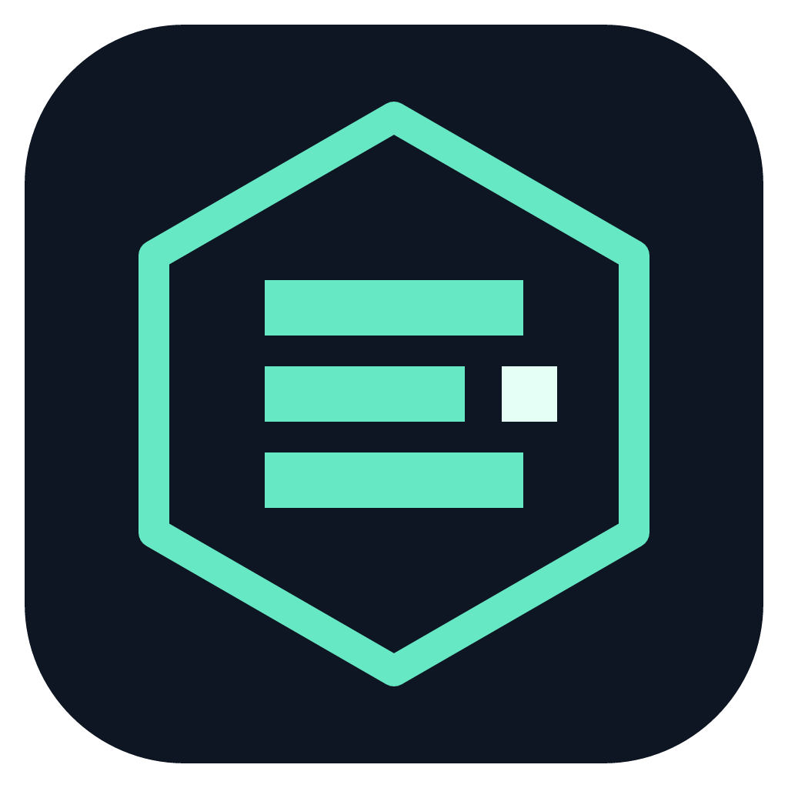

# Eden



Eden is a self-hosted C# server emulator for EVE Online. Play solo or invite friends to a persistent world where simulated
pilots mine, trade, and form corporations.

**Client required** · EVE Online 24.01 for Windows, build 3662168. Supply the matching client and resource cache separately.

**[Set up on Windows](#start-here)** · [Connect and play](#connect-and-play) · [Host with Docker](docs/docker.md) ·
[Gameplay coverage](docs/feature-notes.md#gameplay-overview) · [Documentation](docs/README.md) ·
[Discord](https://discord.gg/ZTxJrZKAXe)

## Start here

### Start a local server on Windows

You’ll need PowerShell 7, 64-bit Python 3.11 or later, and a stable .NET 10 SDK.
[Download the .NET 10 SDK](https://dotnet.microsoft.com/download/dotnet/10.0)

From the repository root, run these commands in PowerShell 7. Replace `E:\Eve` with the folder containing your matching
`tq` and `ResFiles` directories. Use a separate, empty folder in place of `E:\EdenDev\3662168`.

```powershell
.\tools\DevelopmentClient.ps1 -PrepareFrom 'E:\Eve' -DevelopmentRoot 'E:\EdenDev\3662168'
.\tools\Setup-Catalog.ps1 -DevelopmentRoot 'E:\EdenDev\3662168'
dotnet run --no-build --project src/Eden.Server
```

The first command copies and verifies the client. Catalog setup builds the server and downloads the matching game data on
its first run. For staging, offline setup, and troubleshooting, see the [Windows client guide](docs/development-client.md).
On a new save, follow the server console to [World setup](docs/world-configuration.md#first-start) to create an established
world with a seeded market. Account creation and sign-in open once the world is ready.

### Connect and play

1. Open Eden Launcher. In **Settings**, connect to `http://127.0.0.1:26002` for a local server, or use the API address from
   your server host.
2. Select the staged client folder and choose **Use this client**.
3. Choose **Add account** to create an account or sign in. Select the account and click **Play**.

[Get Eden Launcher](https://github.com/CJ-SPT/Eden-Launcher#run) ·
[Build the launcher](https://github.com/CJ-SPT/Eden-Launcher#build-and-verify) ·
[Account setup and remote hosting](docs/launcher.md)

## Customize your world

Use the admin tools to adjust progression, travel, rewards, and production. Eden also supports skill mods, C# server plugins,
and Python client extensions. [World settings](docs/world-configuration.md) · [Modding guide](docs/modding.md)

## Local game data

- `catalog.sqlite` contains game definitions for build 3662168. Catalog setup generates it locally.
- `world.sqlite` saves accounts, pilots, assets, and simulation state. Eden creates it when an administrator approves first-start settings.

The default data directory is `src/Eden.Server/data` when running from source and `data` beside a published executable.
Stop the server before copying or moving an existing world. [Save migration guide](docs/development-client.md#moving-an-existing-server)

## Build and run

Use the commands under [Start here](#start-here) to run a local server. For code milestones, run the checks below from the
repository root in order. Replace the sample hosting filter with the affected tests and their immediate dependencies.

```powershell
dotnet tool restore
dotnet restore --artifacts-path artifacts/feature-tests
dotnet build --no-restore --artifacts-path artifacts/feature-tests
dotnet test --no-build --artifacts-path artifacts/feature-tests --filter 'FullyQualifiedName~Eden.Protocol.Tests.Hosting'
python tests/Eden.Protocol.Tests/Persistence/catalog_setup_test.py
python tests/Eden.Protocol.Tests/Formatting/formatting_policy_test.py
.\tools\Format.ps1 -Check
```

Stop at the first failure. Record the test filter, results, elapsed time, and limitations. Run the full .NET suite only for an
explicitly requested regression check. Documentation changes use documentation checks.

[Contributor guide](AGENTS.md) · [Testing guide](docs/testing.md) · [Architecture and runtime](docs/architecture.md)

## Formatting

After restoring tools and the solution, use `.\tools\Format.ps1` to format files or `.\tools\Format.ps1 -Check` to verify them.
The script runs .NET style rules, CSharpier 1.3.0, and line-width checks. For style-only fixes, use
`dotnet format style --no-restore --severity warn`.

Use four spaces and Allman braces in C#. Use two spaces in project and configuration files. The 140-character limit covers
authored C#, project and solution files, `global.json`, JSON under `.config` and `.vscode`, and `appsettings*.json` and
`launchSettings.json`. Generated code, build outputs, and runtime data are excluded.

Wrap long lines where possible. For unavoidable exceptions, record the repository-relative path with forward slashes, the
exact line, and a reason. For format on save in Visual Studio, VS Code, or Rider, select the repository-local CSharpier tool
and keep EditorConfig enabled. [EditorConfig](.editorconfig) · [Formatting exceptions](tools/formatting-exceptions.json)

## License

Eden’s original source and documentation are available under the MIT License. The Carbon notes cover reference-source
attribution. [MIT License](LICENSE) · [Carbon licensing notes](docs/carbon-license.md)
