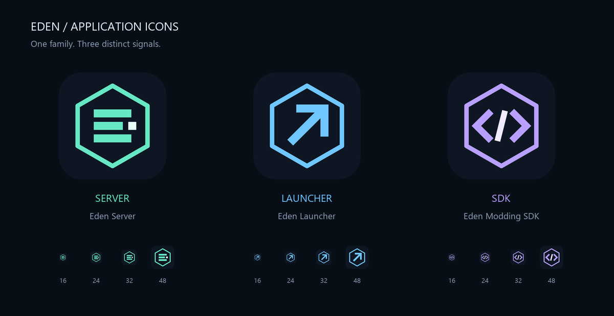

# Eden application icons

Original vector artwork for the Eden application family, distributed under the repository's MIT license.
The common dark tile and hexagonal frame identify the family; both symbol and color distinguish each application.

| Application | Symbol | Accent |
| --- | --- | --- |
| Server | Stacked core / angular E | Teal `#67E8C5` |
| Launcher | Outbound arrow | Blue `#70C7FF` |
| Modding SDK | Code brackets | Violet `#B9A0FF` |



Each icon has an editable, font-independent SVG, a transparent 1024-pixel PNG, and a Windows ICO
containing 16, 20, 24, 32, 40, 48, 64, 128 and 256-pixel images. Transparency surrounds the dark rounded tile.
The preview includes actual 16, 24, 32 and 48-pixel renders. No external artwork or image-generation service is used.

## Export and integration

The SVGs in this directory are the source of truth. To export PNGs, ICOs and the preview:

```powershell
python -m venv artifacts/icon-tools
artifacts/icon-tools/Scripts/python.exe -m pip install pillow==13.0.0 resvg-py==0.5.0
artifacts/icon-tools/Scripts/python.exe tools/Build-Icons.py
```

The server project embeds `eden-server.ico` as its executable icon. Its `wwwroot/eden-server.svg` and
`wwwroot/favicon.ico` are copies used by the local administration header and browser tab.
The launcher and SDK repositories keep their own copies of their corresponding SVG, PNG and ICO under
the desktop project's `Assets` directory. Refresh those copies after changing the canonical artwork;
neither app needs a sibling checkout to build. The launcher uses its icon in its navigation rail,
window and tray; the SDK uses its icon in its header and window. Windows executable icons are embedded at build time.

Automated export and build checks do not establish native desktop, taskbar, tray or browser rendering.

## Validation — November 9, 2026

**Automated validation:** all three SVGs parsed; PNG dimensions and transparency, every ICO size and
byte-identical app copies passed. Windows extracted a 32-pixel embedded icon from each built executable.
Tool/solution restore and zero-warning solution builds passed. The server build took 5.47 seconds;
the exact `AdministrationTests.AuthenticationProtectsEveryOperationAndRequiresLocalHostAndAntiforgery`
filter passed first through `tools/Test-Feature.ps1` (6.51 seconds including runner startup), followed by
`FullyQualifiedName~Eden.Protocol.Tests.Administration.AdministrationTests|FullyQualifiedName~Eden.Protocol.Tests.Administration.AdministrationComponentTests`
(12 passed, six-second runner duration). Both Python policy suites passed (8 and 9 cases).
Formatting and whitespace verification passed. The full .NET suite was not run.

The launcher build used isolated `artifacts/icon-validation` output because the running launcher locked
its normal executable; the initial normal-output build failed for that reason. The isolated build passed
with zero warnings/errors in 4.22 seconds. Its exact `GroupLaunchTests.GroupControlsBindToCommandsAndRequireConnectionAndVerifiedClient`
case passed first, followed by `FullyQualifiedName~Eden.Launcher.Tests.GroupLaunchTests|FullyQualifiedName~Eden.Launcher.Tests.ViewModelTests`
(27 passed, 771-millisecond runner duration). SDK build passed in 2.49 seconds; the exact
`FullyQualifiedName=Eden.Modding.Tools.Tests.DesktopTests.MainWindowAndSkillEditorKeepDraftsAndExplainBonusModes`
filter passed (one case, 656-millisecond runner duration). Both desktop repositories passed formatting checks.

**Live acceptance:** Not performed; agent client testing is disabled.

**Optional maintainer checks:** inspect the rebuilt app icons in Windows Explorer/taskbar and launcher tray;
check the administration browser tab and the launcher/SDK headers at your preferred display scaling.
